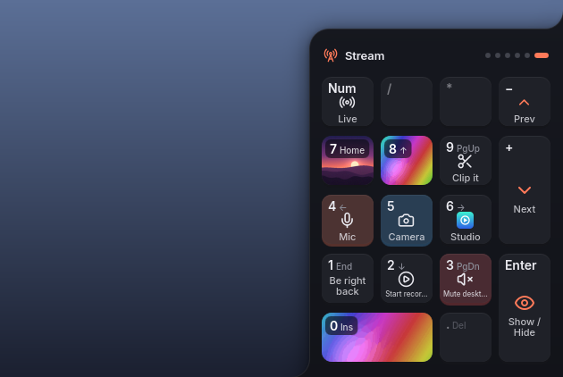
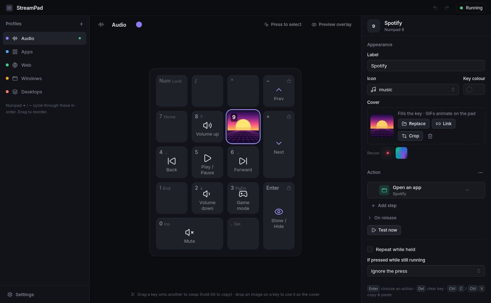
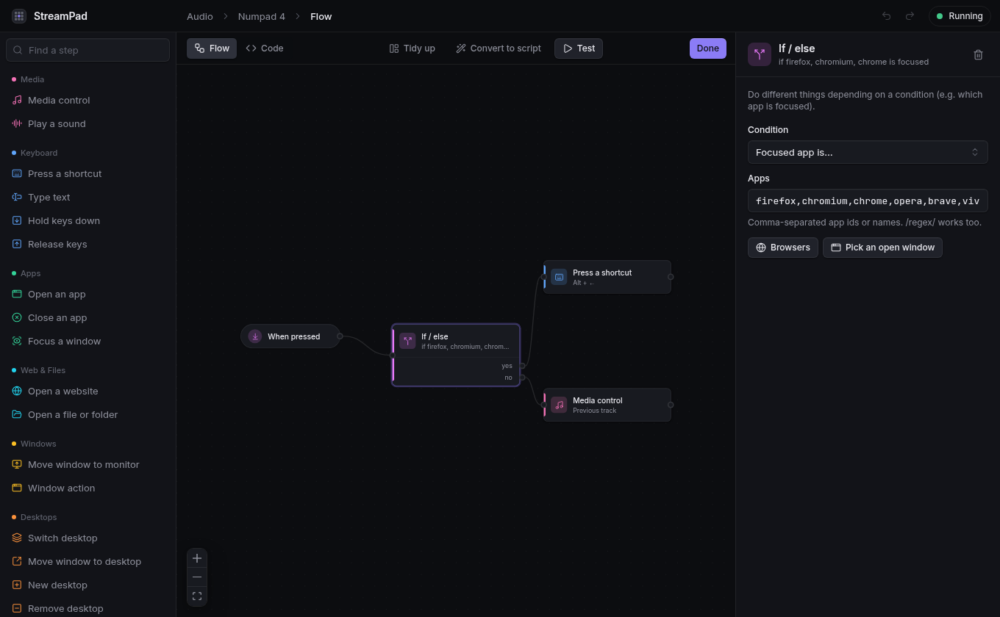

# StreamPad v2

> **Windows v1:** the original AutoHotkey version lives on the [`v1` branch](https://github.com/OMetaVR/Stream-Pad/tree/v1).
> v2 is **Linux only for now** (KDE Plasma 6 on Wayland is the primary target).

Turn your keyboard's numpad into a profile-based macropad, with an on-screen numpad that slides in from the
edge of your screen.

<p align="center">
  
</p>

- **Scroll Lock** flips the numpad between normal numbers and macros (its light shows macro mode).
- In macro mode, **Numpad Enter** shows or hides the on-screen pad (hold it to open the editor),
  **Numpad +** / **−** cycle profiles, and every other key runs its macro.
- The on-screen pad pins to a monitor or follows your mouse, flows into the screen edge with concave
  corners, and shows each key's image/GIF cover, icon and label, or just the key legend ("4 ←").
- The **StreamPad editor** edits profiles and settings: pick actions from a searchable palette, chain steps,
  build branching macros in a node editor, or write JavaScript with autocomplete.

Everything you type outside macro mode passes through untouched.





## Install

Requirements: Rust (1.85+), bun, CMake + Ninja, Qt 6 (Quick, QuickControls2, Svg, ShaderTools) with
layer-shell-qt, and WebKitGTK 4.1. On Arch / EndeavourOS:

```sh
sudo pacman -S --needed rust bun cmake ninja qt6-declarative qt6-svg layer-shell-qt webkit2gtk-4.1
make              # builds the daemon, overlay and editor
make install      # installs to ~/.local and enables the user service
systemctl --user start streampad
```

The daemon needs access to `/dev/input/event*` and `/dev/uinput`. Being in the `input` group is enough;
otherwise `make install` prints how to install `packaging/udev/70-streampad.rules`.

Uninstall with `make uninstall` (your profiles in `~/.config/streampad` are kept).

## Using it

Open **StreamPad** from your launcher (or hold Numpad Enter in macro mode). Click a key, then *Choose an
action*. The default profiles are ports of the original script:

| Profile | Keys |
|---|---|
| Audio | play/pause, previous/next (browser back/forward when a browser is focused), volume, mute, game-mode toggle |
| Apps | focus-or-launch for the apps found on your system (Discord, Firefox, Steam, Spotify, …) |
| Web | YouTube, Google, GitHub, Discord, Twitch, Kick, ChatGPT |
| Windows | move the focused window between monitors, maximize/minimize/keep above/center/fullscreen |
| Desktops | switch / move windows between virtual desktops, new/remove desktop, overview |

Macros can press shortcuts, type text, control media, open apps/URLs/files, run commands, move windows,
switch virtual desktops, trigger any KDE global shortcut, switch profiles, keep variables, show messages on
the pad, branch on the focused app or a variable, loop, and run JavaScript. The full scripting API is in
[`crates/streampad-script/API.md`](crates/streampad-script/API.md).

Window, desktop and "focused app" features use KWin scripting (KDE Plasma 6). Everything else works on any
Wayland compositor or X11; the on-screen pad uses layer-shell (KDE, Hyprland, Sway…).

## How it fits together

| Part | Path | What it does |
|---|---|---|
| `streampadd` | `crates/streampadd` | daemon: grabs keyboards (evdev) and mirrors them through uinput, owns macro mode/profiles/globals, runs macros, talks to KWin, serves a Unix socket |
| input engine | `crates/streampad-input` | lossless per-device mirrors, numpad capture, LEDs, hotplug, synthetic keyboard |
| macro runtime | `crates/streampad-script` | QuickJS sandbox with the StreamPad API; compiled flows and scripts run the same way |
| shared model | `crates/streampad-core` | config schema, IPC protocol, flow → JavaScript compiler |
| `streampad-overlay` | `apps/overlay` | Qt 6 / QML layer-shell on-screen pad |
| `streampad` | `apps/editor` | Tauri 2 + React editor |

Design and protocol details: [`docs/SPEC.md`](docs/SPEC.md).

## Troubleshooting

- **Logs:** `journalctl --user -u streampad -f`
- **Keyboard not listed / permission errors:** Settings › Keyboards shows each device and why it isn't used.
- **Stop it instantly:** `systemctl --user stop streampad` — every grab is released and your keyboard
  goes straight back to normal.
- **Develop without touching your keyboard:** `streampadd --no-input` and drive it with
  `streampadd ctl simulateKey '{"key":"KP4","pressed":true}'`; `cd apps/editor && bun run dev` runs the
  editor in a browser against a simulated daemon.
